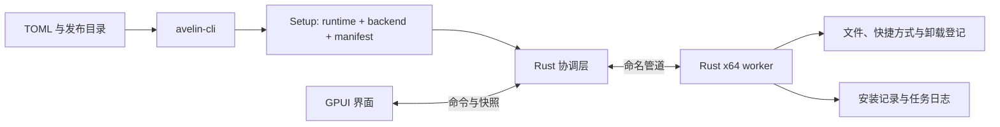

# 架构与代码导览

当前采用 GPUI Kit + Rust 协调层与独立 Rust worker，生成离线单 EXE。GUI 和静默入口、应用配置及持久模型共用。

## 执行路径

每个包携带配套 Rust worker。图形和静默入口使用同一协调逻辑。UI 不直接部署文件或根据动画判定成功。协调层核对后端结果、进程状态和受管资源，确认实际结果后发布终态。

## 阅读顺序

1. `apps/avelin-cli/src/main.rs`：工具命令；`init.rs` 生成配置，`components.rs` 解析组件，`config.rs` 读取配置，`build_output.rs` 保护输出，`native_builder.rs` 打包 Rust worker 与载荷。
2. `crates/avelin-core/src/`：配置、载荷、包格式、安装记录、计划和协议。
3. `apps/avelin-app/src/coordinator.rs`：会话、任务锁、后端进程、GUI/静默流程和结果核验。
4. `crates/avelin-engine/src/`：Rust worker、部署事务、文件归属、系统入口和恢复日志。
5. `crates/avelin-ui/src/`：界面和输入行为。

协调器负责身份、计划、锁、后端生命周期和结果核验；Rust 引擎负责部署与补偿。路径和资源归属检查贯穿整个执行过程。

## 三种状态

| 数据 | 作用 |
|---|---|
| Manifest | 包里的身份、版本、载荷摘要和展示资源 |
| InstallPlan / UpgradePlan | 当前任务操作、选择及核验过的升级差异 |
| Receipt | 已提交安装的身份、版本、资源归属与提交关联 |

任务日志描述执行中的变更，receipt 描述已提交状态，两者不可互代。UI 快照用于显示，不能充当磁盘成功证据。字段见[本地 schemas](schemas/README.md)。

## 包装和执行边界

Rust 包的外层仍为 runtime + backend + manifest；backend 是 x64 Rust worker 加原生载荷和相同 manifest 的第二层 overlay。原生载荷含版本、runtime 和依清单排序的文件字节，当前不压缩。读取时核对边界、长度、文件数量和摘要，拒绝尾随或残缺内容。两层都受既有 1 GiB 嵌入区域上限约束。

运行时核验并释放 Rust worker，通过现有带任务身份的受限命名管道交换结构化进度、取消确认和终态。运行时在启动 worker 前校验原生载荷，拒绝不含有效 Rust 载荷的可执行文件。驻留卸载前端仍先转移到临时目录，再执行归属卸载，以便清理自己的原目录。

升级先暂存和备份，执行变更后最后提交完整 receipt。多文件与注册表变更不是一个原子事务；有限进程内恢复无法确认时返回 Unknown 并保留证据。失联不会直接解释为已取消或成功。

Rust 引擎在会话内保存 `engine-journal.jsonl`（安装、卸载、修复）或 `upgrade-journal.jsonl`（升级）；变更期间使用安装根内的 `.avelin/upgrade-state.json` 标记未完成事务。日志记录变更意图、实际结果、提交或恢复结论；恢复失败保留 `engine-recovery.json`、备份和标记。后续操作检测到未完成标记即拒绝继续覆盖。

新的恢复描述使用 schema 2，绑定原计划、会话、安装实例、受管资源的前后状态和备份。`engine-registry.jsonl` 记录注册表每一步的意图与已刷盘结果；`engine-commit.json` 是独立的持久提交判据。已提交资源与终态确认分开处理，不能因失去终态而盲目回滚已完成的提交。

`diagnose` 保持只读；`recover` 先检查，显式确认后经认证 worker 执行恢复。原进程必须停止，正常 Rust 事务和恢复共用产品互斥。执行层从经核验的包与安装归属重建目标集合，拒绝会话里的任意越界写入指令。未提交事务回退，已提交事务核验确认，最终状态确认后才解除遗留锁和标记。旧记录缺少必要证据时拒绝。

`repair` 使用与原安装一致的包补回缺失资源，默认保留修改项；显式恢复修改项前先备份。修复保持产品版本和安装实例，经过与正常部署一致的准备、变更、核验和提交过程；修复中断也能使用恢复入口。应用用户数据不参与修复。详细行为见[恢复与修复](maintenance.md)。

路径、摘要、用户身份、实例互斥和资源归属均属于执行规则。卸载只删除符合归属与摘要要求的资源，保留未知内容及已修改资源。完整行为见[兼容约定](compatibility.md)。
