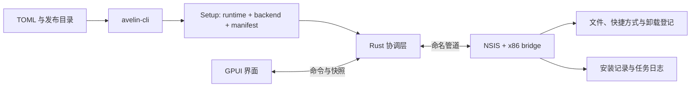

# 架构与代码导览

当前采用 GPUI Kit + Rust 协调层 + NSIS 后端，生成离线单 EXE。Rust 原生部署引擎属于后续专项，尚未实现。

## 执行路径

图形和静默入口使用同一协调逻辑。UI 不直接部署文件或根据动画判定成功。协调层核对后端结果、进程状态和受管资源，确认实际结果后发布终态。

## 阅读顺序

1. `apps/avelin-cli/src/main.rs`：工具命令；`init.rs` 生成配置，`components.rs` 解析组件，`builder.rs` 生成脚本。
2. `crates/avelin-core/src/`：配置、载荷、包格式、安装记录、计划和协议。
3. `apps/avelin-app/src/coordinator.rs`：会话、任务锁、后端进程、GUI/静默流程和结果核验。
4. `crates/avelin-nsis-bridge/src/` 与 `packaging/nsis/`：后端通信、受管操作和脚本模板。
5. `crates/avelin-ui/src/`：界面和输入行为。

协调器和生成器目前承担较多职责。后续拆分应沿包读取、会话、执行和提交边界进行，并用功能回归验证；首次源码公开不同时更换引擎。

## 三种状态

| 数据 | 作用 |
|---|---|
| Manifest | 包里的身份、版本、载荷摘要和展示资源 |
| InstallPlan / UpgradePlan | 当前任务操作、选择及核验过的升级差异 |
| Receipt | 已提交安装的身份、版本、资源归属与提交关联 |

任务日志描述执行中的变更，receipt 描述已提交状态，两者不可互代。UI 快照用于显示，不能充当磁盘成功证据。字段见[本地 schemas](schemas/README.md)。

## 包装和执行边界

CLI 将 x64 runtime、x86 NSIS backend 和 manifest 组装进单 EXE overlay。运行时核验并释放后端，使用带任务身份的受限命名管道通信。bridge 使用 x86 NSIS ABI，与 x64 UI 不要求相同位数。

升级先暂存和备份，执行变更后最后提交完整 receipt。多文件与注册表变更不是一个原子事务；有限进程内恢复无法确认时返回 Unknown 并保留证据。失联不会直接解释为已取消或成功。

路径、摘要、用户身份、实例互斥和资源归属均属于执行规则。卸载只删除符合归属与摘要要求的资源，保留未知内容及已修改资源。完整行为见[兼容约定](compatibility.md)。
